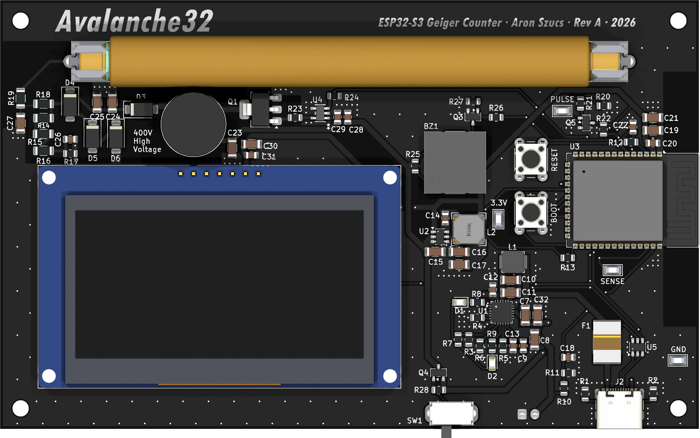
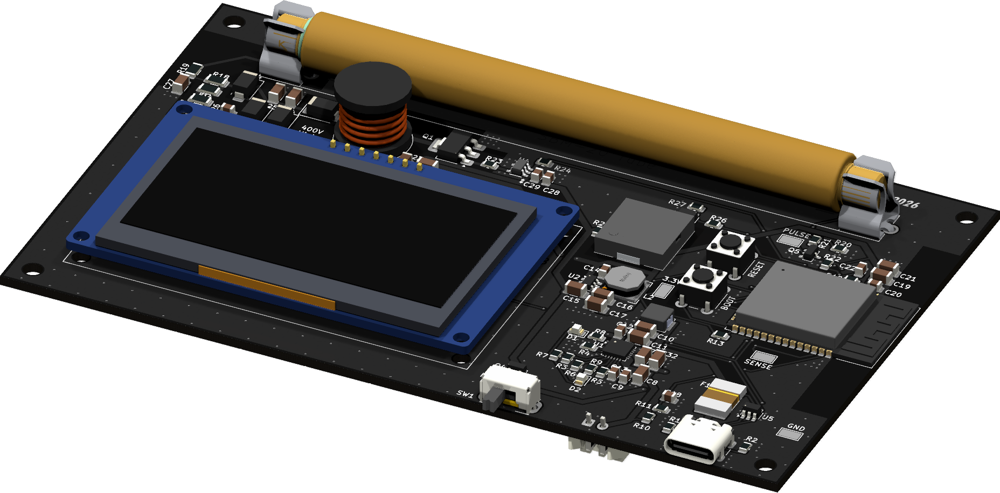
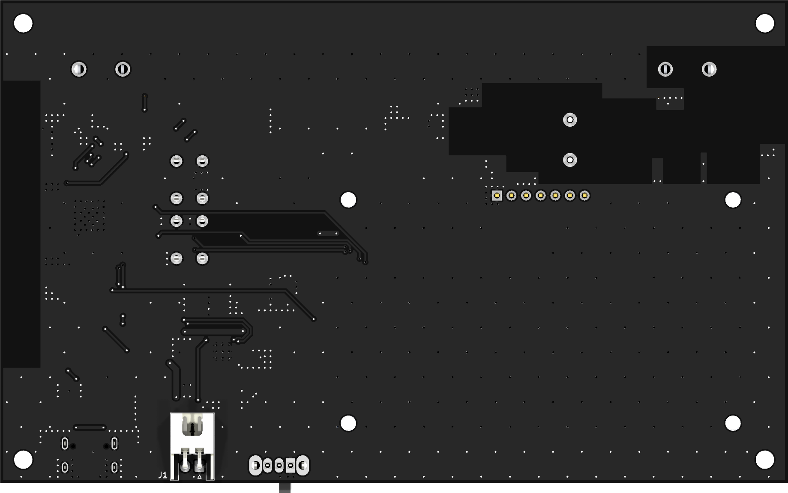

# Avalanche32: ESP32-S3 Geiger Counter

A handheld, battery-powered Geiger counter built around the **ESP32-S3-WROOM-1** and a Soviet **SBM-20** Geiger–Müller tube. It has a firmware-regulated ~400 V supply, an audible click for each count, a 2.42" OLED display, and a single USB-C port for both charging and programming.



> **Status: Rev A, in progress.** The perfboard prototype is working: it regulates the tube supply at 370–400 V, counts background radiation, and clearly detects real radioactive sources (see [Measurements](#measurements)). The Rev A schematic and PCB layout are complete and the fabrication files have been generated. Rev A boards have not yet been assembled or tested.

| Front | Back |
|---|---|
|  |  |

## Hardware Overview

| Block | Implementation |
|---|---|
| MCU | ESP32-S3-WROOM-1, native USB (no USB-UART bridge), BOOT and RESET buttons |
| Battery | 2S Li-ion / LiPo pack (7.4 V nominal, 6.0–8.4 V) on a JST-XH connector |
| Charger | TI BQ25886 2-cell boost charger with power-path management, charge-status and power-good LEDs |
| USB-C | 5 V input (5.1 kΩ CC pull-downs, no USB PD), 3 A polyfuse on VBUS, USBLC6-2 ESD protection on the data lines |
| Power switch | Slide switch driving an AO3401A P-FET load switch. The charger stays active, so the pack charges with the unit switched off. |
| 3.3 V rail | Diodes AP63203 synchronous buck converter |
| High voltage | Firmware-regulated boost from the system rail to ~400 V (details below) |
| Detection | SBM-20 cathode pulse → MMBT3904 pulse shaper → ESP32 interrupt |
| Audio | Piezo transducer switched by a 2N7002 low-side MOSFET, one click per count |
| Display | 2.42" 128×64 SSD1309 OLED module over SPI |
| Battery monitor | 1 MΩ / 330 kΩ divider into an ESP32 ADC input |

### High-Voltage Supply

- **Topology:** discontinuous-mode boost converter. The ESP32 drives a UCC27517 gate driver, which switches an STN1HNK60 600 V MOSFET into a 10 mH inductor, with a US1M fast-recovery rectifier.
- **Regulation:** closed-loop hysteretic control. A 3 × 100 MΩ + 680 kΩ divider (with a 2.2 nF filter cap) feeds the ESP32 ADC, and the firmware gates the boost pulses to hold the setpoint.
- **Protection:** a 450 V Zener clamp (3 × 150 V in series) on the output, plus a firmware overvoltage shutdown.
- **Filtering:** a 20 nF / 1 kV reservoir, then a 1 MΩ / 10 nF RC ripple filter, then a 5.1 MΩ anode resistor into the tube.
- **Layout:** the HV section sits in its own isolated area with a "400V High Voltage" marking on the silkscreen.

### GPIO Map (Rev A PCB)

| Signal | ESP32-S3 GPIO |
|---|---|
| HV_PWM (gate driver input) | IO4 |
| HV_SENSE (HV divider, ADC1) | IO2 |
| PULSE (tube pulse, active low) | IO5 |
| PIEZO | IO6 |
| VBAT_SENSE (ADC1) | IO1 |
| OLED SCK / MOSI / CS / DC / RST | IO12 / IO11 / IO10 / IO13 / IO21 |
| USB D− / D+ | IO19 / IO20 |

Test points are provided for 3.3 V, GND, PULSE and HV_SENSE.

### PCB

| Parameter | Value |
|---|---|
| Dimensions | 137 × 84 mm |
| Layers | 2 (1.6 mm FR-4, 1 oz copper) |
| Finish | Black solder mask, white silkscreen, HASL |
| Mounting | 4 × M3 mounting holes |

## Measurements

These readings are from the perfboard prototype, with each sample placed directly against the SBM-20 tube. Dose rates use the firmware's conversion factor of 0.0057 µSv/h per CPM (SBM-20, Cs-137 basis), so they are indicative only.

| Source | CPM | × Background | Indicated µSv/h |
|---|---|---|---|
| Normal indoor background | 15–25 | 1× | ~0.09–0.14 |
| Uranium glass plate | 300–400 | ~17× | ~1.7–2.3 |
| Vintage radium-dial watch | 350–450 | ~20× | ~2.0–2.6 |
| Watch + plate together | 550–650 | ~30× | ~3.1–3.7 |

## Known Issue: Tube Re-Firing

The current SBM-20 sometimes fails to quench. Instead of a single pulse, it fires a burst of 100–1000+ pulses spaced about 150–200 µs apart. Bursts become more frequent at higher voltage, which points to a degraded tube; a replacement is on order.

As a workaround, the firmware has an optional burst filter (`BURST_FILTER`). A count only registers after 5 ms of quiet, so each burst counts once. Raw pulses and filtered counts are tracked separately for diagnostics.

## Firmware

`Firmware/HV_Test/HV_Test.ino` is a bench test for the HV supply and counting chain, written for the Arduino ESP32 core. It provides:

- Hysteretic HV regulation (370 V setpoint, 5 V hysteresis) with a 460 V overvoltage shutdown.
- An interrupt-driven pulse counter with the optional burst filter.
- A 60-second rolling CPM and an estimated µSv/h.
- A 4 kHz piezo click for each count.
- Serial output at 115200 baud showing HV, boost on-time, total and raw counts, CPM and µSv/h. To change the boost on-time, send a number from 5 to 120 (µs).

> **Note:** this sketch targets the perfboard prototype, which uses a classic ESP32 dev board. Its pin assignments (IO4, IO35, IO27, IO25) do **not** match the Rev A PCB. Update the constants at the top of the file using the [GPIO map](#gpio-map-rev-a-pcb) before running it on the PCB.

## Repository Layout

| Path | Contents |
|---|---|
| `ESP32-Geiger-Counter.kicad_*` | KiCad project: schematic, PCB and design rules |
| `Custom Parts.kicad_sym`, `libs/` | Custom symbols, footprints and 3D models |
| `production/` | JLCPCB fabrication outputs: Gerber/drill archive, BOM, pick-and-place and IPC netlist |
| `bom/ibom.html` | Interactive BOM for hand assembly |
| `Images/` | 3D renders (`3D/`) and per-layer plots (`Layers/`) |
| `scripts/generate_images.py` | Regenerates everything in `Images/` using `kicad-cli` |
| `Firmware/` | ESP32 firmware |
| `Draft1.asc` | LTspice simulation of the HV boost |

To regenerate the images (requires KiCad 9+ and, for PNG layer plots, `pip install pymupdf`):

```sh
python scripts/generate_images.py
```

## Roadmap

- [x] HV boost designed and simulated in LTspice
- [x] Perfboard HV prototype with regulation verified at 370–400 V
- [x] SBM-20 background count test (15–25 CPM indoors)
- [x] Source tests: uranium glass and radium-dial watch detected (up to ~30× background)
- [x] Bench-test firmware: hysteretic HV control, rolling CPM, µSv/h estimate, piezo click
- [x] Full schematic: power, charger, ESP32-S3, HV supply, detector and display
- [x] Rev A PCB layout and fabrication outputs
- [ ] Rev A fabrication, assembly and bring-up
- [ ] Application firmware: OLED UI, menus, dose alarm, logging, battery monitoring

## Tools

KiCad · LTspice · Arduino (ESP32 core) · C++

## ⚠️ Safety

This device generates **~400 V DC**. The stored energy is small, but do not touch the HV section while the unit is powered. Before handling the board, let the capacitors discharge: wait for the HV reading to fall to 0 V.

Store radioactive test samples (radium dials, uranium glass) sealed and away from living spaces. Never open radium-dial watches or gauges.
